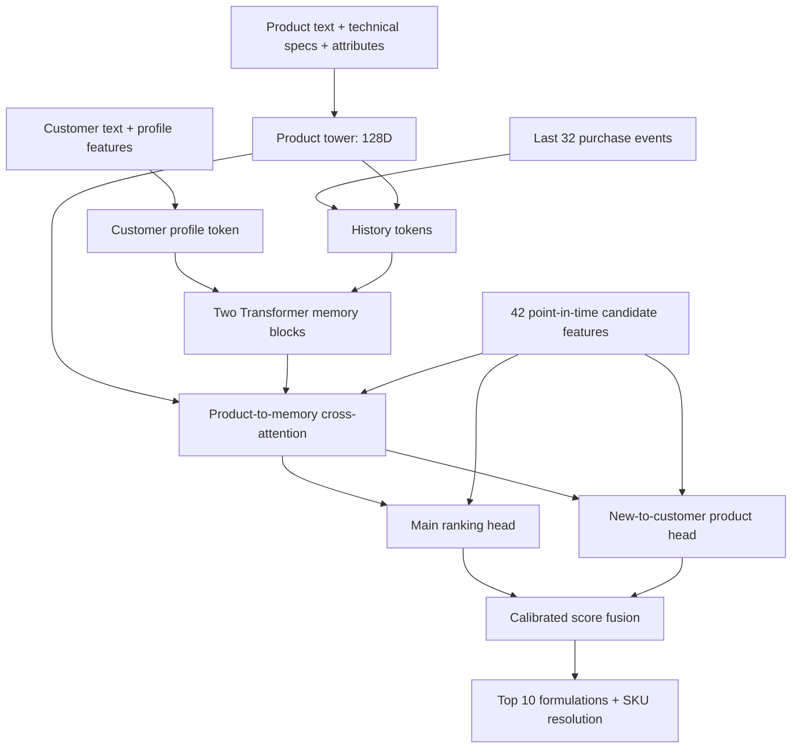

<div align="center">

# Enterprise Product Recommendation System

### An end-to-end Transformer-based engine for B2B next-basket prediction

Predict what a business customer will buy next using **real ERP transactions**, semantic product embeddings, purchase-history attention and point-in-time commercial features.

[](https://www.python.org/)
[](https://pytorch.org/)
[](https://huggingface.co/BAAI/bge-m3)
[](https://catboost.ai/)
[](https://pandas.pydata.org/)
[](https://docs.pytest.org/)
[](https://docs.astral.sh/ruff/)

**Privacy-first · End-to-end learning · Leakage-aware · Full-catalogue ranking · CPU inference**

| Recall@10 · trained entities | Recall@10 · full test | Training baskets | CPU model inference |
| :---: | :---: | :---: | :---: |
| **83.03%** | **76.63%** | **137,765** | **7.17 ms** |

83.03% Recall@10 on 9,839 held-out orders involving customers and products represented during training; 76.63% across all 13,184 held-out orders. CPU latency is the median model-forward time on Colab, excluding upstream feature preparation.

[Results](#evaluation) · [Architecture](#architecture) · [Technology stack](#technology-stack) · [Model evolution](#model-evolution) · [Quick start](#quick-start)

</div>

---

## Why this project stands out

B2B purchasing is shaped by replenishment cycles, technical product requirements and customer-specific commercial context. The engine ranks both repeat purchases and products a customer has never bought, returning the ten most relevant formulations with a deterministic SKU resolver.

This repository implements the full machine learning lifecycle, rather than just a training script:

- prepares multi-year ERP data and builds strictly chronological evaluation splits;
- extracts semantic embeddings, technical product specifications, transactional and collaborative filtering features;
- develops and benchmarks CatBoost, Two-Tower retrieval, neural reranking and full-catalogue architectures;
- jointly trains product and customer representations using a custom 1.37M-parameter Transformer ranker;
- improves product discovery through a dedicated prediction head, auxiliary supervision and out-of-fold calibration;
- diagnoses temporal leakage, cold-start performance and the effects of recency weighting;
- serves predictions through a local interactive PyTorch inference server.

## What this demonstrates

| Area | Evidence in this repository |
|---|---|
| Deep learning | Jointly trained product and customer encoders, Transformer memory, statistics-biased cross-attention |
| Classical ML | CatBoost baselines, collaborative filtering, full-catalogue learning to rank |
| Data engineering | ERP cleaning, product identity resolution, rolling point-in-time feature computation |
| Applied ML research | Architecture comparisons, feature ablations, temporal-shift and cold-start analysis |
| Training optimization | AdamW, CUDA BF16, cosine scheduling, multi-task learning, recency-weighted loss |
| Reproducibility | Fixed seeds, checkpoint provenance, SHA-256 verification, saved evaluation reports |
| Software engineering | Modular Python package, CLI, regression tests, Ruff |
| Model serving | Cached product embeddings, vectorized CPU ranking, interactive local HTTP server |

## Architecture

The final `Wave2BE2ERanker` scores the entire modeled catalogue in one pass. Product representations and customer encoders are jointly optimized for ranking, with product embeddings cached at catalogue refresh for CPU serving.



| Component | Implementation |
| :--- | :--- |
| Semantic representation | BAAI BGE-M3, 1,024-dimensional embeddings |
| Product tower | Text, 65 structured technical-spec features and categorical embeddings → 128D |
| Customer memory | Profile token + up to 32 historical product tokens; two Transformer layers, eight attention heads |
| Candidate interaction | Product-query cross-attention with learned bilinear statistical bias |
| Ranking | Main MLP and separate discovery head, with customer-grouped OOF affine calibration |
| Training | AdamW, cosine learning-rate schedule, gradient clipping, CUDA bfloat16 mixed precision, 60-day auxiliary supervision and recency weighting |
| Serving | Cached product embeddings; vectorized full-catalogue ranking on CPU |

The promoted model has 1,370,564 trainable parameters and was trained in approximately 47 minutes in the recorded CUDA run. Its reference CPU model-forward benchmark reports 7.17 ms median and 8.64 ms p95 over all 1,141 formulations.

[Model implementation](recommender/experiments/v2_full/wave2b_models.py) · [Training pipeline](recommender/experiments/v2_full/run_v2_full_wave2.py) · [CatBoost benchmark](recommender/experiments/v2_full/run_v2_full_catboost.py)

## Technology stack

<div align="center">


&nbsp;&nbsp;

&nbsp;&nbsp;

&nbsp;&nbsp;

&nbsp;&nbsp;

&nbsp;&nbsp;

&nbsp;&nbsp;

&nbsp;&nbsp;


</div>

| Area | Technologies |
| :--- | :--- |
| Language | Python 3.12 |
| Deep learning | PyTorch, CUDA, Transformer encoders, multi-head attention, mixed precision |
| NLP / embeddings | Hugging Face Transformers, Sentence Transformers, BGE-M3 |
| Classical ML | CatBoost, scikit-learn, collaborative filtering |
| Data engineering | NumPy, pandas, Apache Arrow / Parquet, openpyxl |
| Experimentation | Jupyter, Google Colab, chronological backtesting, ablation studies, ranking metrics |
| Software engineering | pytest, Ruff, Git, SHA-256 artifact verification |
| Inference and demo | Python HTTP server, PyTorch CPU inference, HTML/CSS/JavaScript |

## Evaluation

The final model was selected on chronological validation data before held-out testing. The table reports the promoted discovery checkpoint at epoch 10. Recall@10 is averaged across baskets; the primary prediction unit is the canonical product formulation, not an individual packaging SKU.

| Chronological partition | Baskets | Date range |
| :--- | ---: | :--- |
| Training | 137,765 | Before 2026-02-01 |
| Validation | 16,623 | February–June 2026 |
| Held-out test | 13,184 | July–November 2026 |

**1,141 modeled formulations · 1,660 SKUs · 167,572 baskets across the three partitions.**

| Evaluation scope | Recall@10 | NDCG@10 | New-to-customer Recall@10 |
| :--- | ---: | ---: | ---: |
| Validation, all baskets | 82.26% | 0.6548 | 27.91% |
| Held-out test, all baskets | **76.63%** | **0.5841** | **21.71%** |
| Held-out test, trained customers and products (9,839 baskets) | 83.03% | 0.6349 | 15.69% |

The full test result retains targets outside the modeled catalogue rather than silently dropping them. Exact-SKU Recall@10 is 54.15% after variant resolution. On average, test orders occurred 225 days after the last training purchase.

### Baseline comparison

All three rows below use the same v2 validation scope of 16,623 baskets.

| Model | Recall@10 | NDCG@10 | New-to-customer Recall@10 |
| :--- | ---: | ---: | ---: |
| CatBoost + calibrated discovery head | 81.61% | 0.6438 | 25.33% |
| End-to-end Transformer, uniform weighting | 82.18% | 0.6542 | 27.31% |
| **End-to-end Transformer, recency weighting** | **82.26%** | **0.6548** | **27.91%** |

The final model improves validation Recall@10 by 0.65 percentage points over the CatBoost benchmark and retrieves 116 additional new-to-customer targets (1,255 versus 1,139).

### Generalization under temporal shift

A controlled held-out comparison isolates the effect of exponential recency weighting (365-day half-life).

| Test cohort | Uniform weighting | Recency weighting | Change |
| :--- | ---: | ---: | ---: |
| All baskets | 75.84% | 76.63% | +0.79 pp |
| Customers or products unseen in training | 54.49% | 57.80% | +3.31 pp |
| Unseen products within modeled catalogue | 60.31% | 66.29% | **+5.98 pp** |
| Unseen customers | 61.44% | 61.21% | −0.23 pp |

Recency weighting improves product generalization but does not solve customer cold start. First-observed customer baskets achieve 36.82% Recall@10 on the full test set. These are offline ranking metrics, not measured revenue or conversion uplift.

Evidence: [model reference and validation](experiments/v2_full/v2_full_reference.json) · [held-out test report](experiments/v2_full/v2_full_heldout_test_results.json) · [recency ablation](experiments/v2_full/v2_full_recency_vs_uniform_test_comparison.json)

## Model evolution

The project evolved through controlled experiments, not simply through increasing model complexity.

| Phase | Main engineering decision | Validation Recall@10 |
| :--- | :--- | ---: |
| Global popularity | Establish a full-catalogue reference | 17.88% |
| Two-Tower retrieval | Learn customer and product representations | 47.60% |
| Neural reranking (UPS-CANR) | Add candidate-conditioned purchase-history attention | 66.69% |
| Standalone CatBoost | Test whether engineered statistics outperform deep retrieval and ranking | 75.82% |
| Statistics-aware neural reranking | Incorporate rolling features and remove future-information leakage | 77.10% |
| Full-pool formulation ranker | Consolidate package variants; remove candidate truncation | 80.89% |
| Joint E2E architecture | Train representations directly against the ranking objective | 82.18% |
| Final model | Add recency weighting and calibrated product discovery | **82.26%** |

These are historical milestones, **not a single controlled leaderboard**: earlier phases use the v1 SKU dataset (6,191 validation baskets), the full-pool phase uses canonical formulations (6,480), and the final two use the expanded v2 dataset (16,623). The first prototypes used sampled candidate sets and are excluded from the numerical comparison. Earlier measurements also preceded some leakage corrections. See [the full project history](PROJECT_HISTORY.md) for experimental scopes and the chronological engineering log.

## Core engineering decisions

### Product identity and meaningful discovery

A data audit found that 24.5% of previously classified new-SKU targets were packaging changes rather than genuinely new formulations. Canonicalizing product identity made discovery evaluation more meaningful.
### Full-catalogue ranking instead of candidate truncation

For a catalogue of this size, direct scoring removes the retrieval recall ceiling without requiring an approximate-nearest-neighbor service.
### Leakage-resistant temporal evaluation

Demand, purchase-history and commercial features must be available before the query timestamp. Validation and test are chronologically separated; artifact provenance protects against accidental reuse.
### Evidence-driven model development

Frozen tower representations and several alternative attention biases reduced discovery performance. The strong CatBoost baseline and these negative results informed subsequent architectural changes.

## Quick start

### 1. Install dependencies

```bash
git clone https://github.com/RODIONOLIINYK/enterprise-product-recommendation-system.git
cd enterprise-product-recommendation-system
python3.12 -m venv .venv
source .venv/bin/activate
python -m pip install -r requirements-dev.txt
```

### 2. Explore the pipeline

Inspect the data preparation and model training interfaces:

```bash
python -m recommender --help
python -m recommender.experiments.v2_full.run_v2_full_wave2 --help
python -m recommender.experiments.v2_full.live_demo_server --help
```

### 3. Run live inference

Launch interactive inference with an authorized local demo bundle:

```bash
python -m recommender.experiments.v2_full.live_demo_server \
  --bundle /path/to/test_live_bundle.pt.gz
```

The demo runs locally at `http://127.0.0.1:8799/` and supports live model predictions and latency benchmarking. Full training or live inference requires authorized local artifacts; see [Privacy and reproducibility](#privacy-and-reproducibility).

## Repository map

| Path | Purpose |
| :--- | :--- |
| [`recommender/`](recommender/) | Data preparation, features, ranking and evaluation |
| [`recommender/experiments/v2_full/`](recommender/experiments/v2_full/) | Final model, training, calibration and live inference |
| [`experiments/v2_full/`](experiments/v2_full/) | Aggregate evaluation evidence and model reference |
| [`tests/`](tests/) | Regression and pipeline tests |
| [`notebooks/`](notebooks/) | Data exploration and experiment orchestration |
| [`PROJECT_HISTORY.md`](PROJECT_HISTORY.md) | Chronological model development and research decisions |

## Testing and code quality

```bash
python -m pytest
ruff check .
```

The repository includes regression tests for feature generation, temporal evaluation, model architectures and artifact handling.

## Privacy and reproducibility

Source code and aggregate evaluation reports are public. Raw ERP records, private customer data, cached embeddings, trained checkpoints and customer-level demo bundles remain local and are excluded from version control. A fresh public checkout cannot reproduce the private-data benchmarks or launch trained inference without authorized artifacts.

## Project status

Production-oriented research and engineering prototype with a local inference demonstration and chronological held-out evaluation. Remaining work includes stronger cold-start generalization, ongoing model-drift monitoring and prospective evaluation of business impact.

**Author:** Rodion Oliinyk
