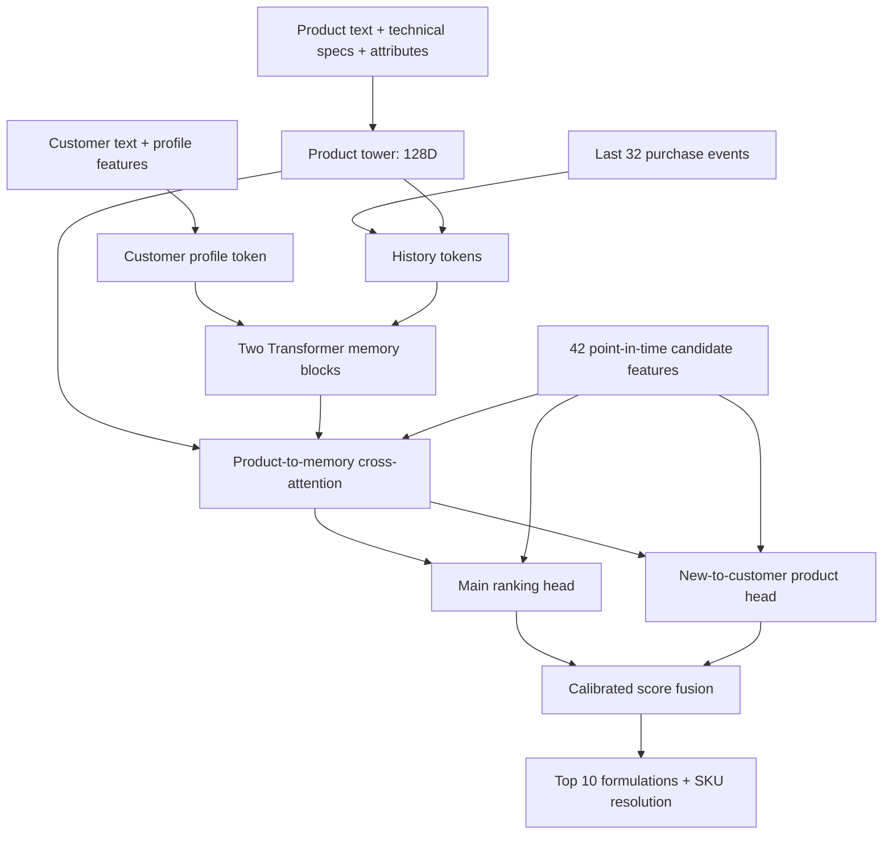

# Enterprise Product Recommendation System

**A B2B next-basket recommendation engine built on real ERP transaction data, combining semantic embeddings, purchase-history Transformers and point-in-time commercial features to predict what a business customer will buy next.**

`Python` · `PyTorch` · `Transformers` · `CatBoost` · `Learning to Rank` · `Recommender Systems`

| Held-out Recall@10 | Training baskets | Model size | CPU inference |
| :---: | :---: | :---: | :---: |
| **76.63%** | **137,765** | **1.37M parameters** | **7.17 ms median** |

Evaluated on **13,184 future orders**; Recall@10 reaches **83.03%** for customers and products represented during training. The deployed-style inference benchmark scores all 1,141 modeled product formulations on a Colab CPU, excluding upstream feature preparation. [Evaluation results](#evaluation) · [Architecture](#architecture) · [Run locally](#run-locally)

## The problem

Unlike consumer recommenders, B2B purchasing is driven by replenishment cycles, technical product requirements, purchasing patterns and customer-specific commercial context. The system must recommend both previously purchased products and products that a customer has never bought.

Given a customer, their purchase history and information available at recommendation time, the engine ranks the product catalogue and returns the ten most relevant formulations, with a deterministic resolver for purchasable SKU variants.

## Engineering highlights

- Designed and trained a custom, end-to-end attention-based ranking architecture rather than relying on an off-the-shelf recommender.
- Built chronological data preparation and rolling feature pipelines over a multi-year ERP ledger, including safeguards against temporal leakage.
- Combined multilingual semantic embeddings, parsed technical specifications, collaborative filtering signals and transactional statistics.
- Benchmarked neural architectures against global popularity and CatBoost, then eliminated the retrieval stage when full-catalogue scoring proved practical.
- Implemented a separate product-discovery head, multi-task supervision, customer-grouped out-of-fold calibration and recency-weighted training.
- Built a local interactive PyTorch inference server, benchmark tooling, regression tests and checksum-verified model artifacts.

## Evaluation

The final model was selected on chronological validation data before held-out testing. The table reports the promoted discovery checkpoint at epoch 10. Recall@10 is averaged across baskets; the primary prediction unit is the canonical product formulation, not an individual packaging SKU.

| Chronological partition | Baskets | Date range |
| :--- | ---: | :--- |
| Training | 137,765 | Before 2026-02-01 |
| Validation | 16,623 | February–June 2026 |
| Held-out test | 13,184 | July–November 2026 |

**1,141 modeled formulations · 1,660 SKUs · 167,572 baskets across the three partitions.**

| Evaluation scope | Recall@10 | NDCG@10 | New-to-customer Recall@10 |
| :--- | ---: | ---: | ---: |
| Validation, all baskets | 82.26% | 0.6548 | 27.91% |
| Held-out test, all baskets | **76.63%** | **0.5841** | **21.71%** |
| Held-out test, trained customers and products (9,839 baskets) | 83.03% | 0.6349 | 15.69% |

The full test result retains targets outside the modeled catalogue rather than silently dropping them. Exact-SKU Recall@10 is 54.15% after variant resolution. On average, test orders occurred 225 days after the last training purchase.

### Baseline comparison

All three rows below use the same v2 validation scope of 16,623 baskets.

| Model | Recall@10 | NDCG@10 | New-to-customer Recall@10 |
| :--- | ---: | ---: | ---: |
| CatBoost + calibrated discovery head | 81.61% | 0.6438 | 25.33% |
| End-to-end Transformer, uniform weighting | 82.18% | 0.6542 | 27.31% |
| **End-to-end Transformer, recency weighting** | **82.26%** | **0.6548** | **27.91%** |

The final model improves validation Recall@10 by 0.65 percentage points over the CatBoost benchmark and retrieves 116 additional new-to-customer targets (1,255 versus 1,139).

### Generalization under temporal shift

A controlled held-out comparison isolates the effect of exponential recency weighting (365-day half-life).

| Test cohort | Uniform weighting | Recency weighting | Change |
| :--- | ---: | ---: | ---: |
| All baskets | 75.84% | 76.63% | +0.79 pp |
| Customers or products unseen in training | 54.49% | 57.80% | +3.31 pp |
| Unseen products within modeled catalogue | 60.31% | 66.29% | **+5.98 pp** |
| Unseen customers | 61.44% | 61.21% | −0.23 pp |

Recency weighting improves product generalization but does not solve customer cold start. First-observed customer baskets achieve 36.82% Recall@10 on the full test set. These are offline ranking metrics, not measured revenue or conversion uplift.

Evidence: [model reference and validation](experiments/v2_full/v2_full_reference.json) · [held-out test report](experiments/v2_full/v2_full_heldout_test_results.json) · [recency ablation](experiments/v2_full/v2_full_recency_vs_uniform_test_comparison.json)

## Architecture

The final `Wave2BE2ERanker` scores the entire modeled catalogue in one pass. Product representations and customer encoders are jointly optimized for ranking, with product embeddings cached at catalogue refresh for CPU serving.



| Component | Implementation |
| :--- | :--- |
| Semantic representation | BAAI BGE-M3, 1,024-dimensional embeddings |
| Product tower | Text, 65 structured technical-spec features and categorical embeddings → 128D |
| Customer memory | Profile token + up to 32 historical product tokens; two Transformer layers, eight attention heads |
| Candidate interaction | Product-query cross-attention with learned bilinear statistical bias |
| Ranking | Main MLP and separate discovery head, with customer-grouped OOF affine calibration |
| Training | AdamW, cosine learning-rate schedule, gradient clipping, CUDA bfloat16 mixed precision, 60-day auxiliary supervision and recency weighting |
| Serving | Cached product embeddings; vectorized full-catalogue ranking on CPU |

The promoted model has 1,370,564 trainable parameters and was trained in approximately 47 minutes in the recorded CUDA run. Its reference CPU model-forward benchmark reports 7.17 ms median and 8.64 ms p95 over all 1,141 formulations.

[Model implementation](recommender/experiments/v2_full/wave2b_models.py) · [Training pipeline](recommender/experiments/v2_full/run_v2_full_wave2.py) · [CatBoost benchmark](recommender/experiments/v2_full/run_v2_full_catboost.py)

## Model evolution

The project evolved through controlled experiments, not simply through increasing model complexity.

| Phase | Main engineering decision | Validation Recall@10 |
| :--- | :--- | ---: |
| Global popularity | Establish a full-catalogue reference | 17.88% |
| Two-Tower retrieval | Learn customer and product representations | 47.60% |
| Neural reranking (UPS-CANR) | Add candidate-conditioned purchase-history attention | 66.69% |
| Standalone CatBoost | Test whether engineered statistics outperform deep retrieval and ranking | 75.82% |
| Statistics-aware neural reranking | Incorporate rolling features and remove future-information leakage | 77.10% |
| Full-pool formulation ranker | Consolidate package variants; remove candidate truncation | 80.89% |
| Joint E2E architecture | Train representations directly against the ranking objective | 82.18% |
| Final model | Add recency weighting and calibrated product discovery | **82.26%** |

These are historical milestones, **not a single controlled leaderboard**: earlier phases use the v1 SKU dataset (6,191 validation baskets), the full-pool phase uses canonical formulations (6,480), and the final two use the expanded v2 dataset (16,623). The first prototypes used sampled candidate sets and are excluded from the numerical comparison. Earlier measurements also preceded some leakage corrections. See [the full project history](PROJECT_HISTORY.md) for experimental scopes and the chronological engineering log.

### Decisions that mattered

- **Measure the right target.** A data audit found that 24.5% of previously classified new-SKU targets were packaging changes rather than genuinely new formulations. Canonicalizing product identity made discovery evaluation more meaningful.
- **Simplify when evidence supports it.** For a catalogue of this size, direct scoring removes the retrieval recall ceiling without requiring an approximate-nearest-neighbor service.
- **Treat time as a first-class constraint.** Demand, purchase-history and commercial features must be available before the query timestamp. Validation and test are chronologically separated; artifact provenance protects against accidental reuse.
- **Preserve unsuccessful experiments.** Frozen tower representations and several alternative attention biases reduced discovery performance. The strong CatBoost baseline and these negative results informed subsequent architectural changes.

## Technology stack

| Area | Technologies |
| :--- | :--- |
| Language | Python 3.12 |
| Deep learning | PyTorch, CUDA, Transformer encoders, multi-head attention, mixed precision |
| NLP / embeddings | Hugging Face Transformers, Sentence Transformers, BGE-M3 |
| Classical ML | CatBoost, scikit-learn, collaborative filtering |
| Data engineering | NumPy, pandas, Apache Arrow / Parquet, openpyxl |
| Experimentation | Jupyter, Google Colab, chronological backtesting, ablation studies, ranking metrics |
| Software engineering | pytest, Ruff, Git, SHA-256 artifact verification |
| Inference and demo | Python HTTP server, PyTorch CPU inference, HTML/CSS/JavaScript |

## Run locally

```bash
git clone https://github.com/RODIONOLIINYK/enterprise-product-recommendation-system.git
cd enterprise-product-recommendation-system
python3.12 -m venv .venv
source .venv/bin/activate
python -m pip install -r requirements-dev.txt
```

Explore the data preparation and model training interfaces:

```bash
python -m recommender --help
python -m recommender.experiments.v2_full.run_v2_full_wave2 --help
python -m recommender.experiments.v2_full.live_demo_server --help
```

To launch interactive inference with an authorized local demo bundle:

```bash
python -m recommender.experiments.v2_full.live_demo_server \
  --bundle /path/to/test_live_bundle.pt.gz
```

The demo runs locally at `http://127.0.0.1:8799/` and supports live model predictions and latency benchmarking. The source code and aggregate evaluation artifacts are public; private ERP data, embeddings, checkpoints and customer-level demo bundles are not included. Full training or live inference requires authorized local artifacts, so a fresh public checkout cannot reproduce the private-data benchmark by itself.

## Repository map

| Path | Purpose |
| :--- | :--- |
| [`recommender/`](recommender/) | Data preparation, features, ranking and evaluation |
| [`recommender/experiments/v2_full/`](recommender/experiments/v2_full/) | Final model, training, calibration and live inference |
| [`experiments/v2_full/`](experiments/v2_full/) | Aggregate evaluation evidence and model reference |
| [`tests/`](tests/) | Regression and pipeline tests |
| [`notebooks/`](notebooks/) | Data exploration and experiment orchestration |
| [`PROJECT_HISTORY.md`](PROJECT_HISTORY.md) | Chronological model development and research decisions |

## Project status

Production-oriented research and engineering prototype with a local inference demonstration and chronological held-out evaluation. Remaining work includes stronger cold-start generalization, ongoing model-drift monitoring and prospective evaluation of business impact.

**Author:** Rodion Oliinyk
